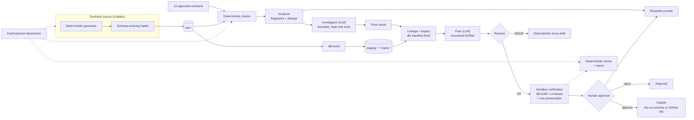

# dqs — Agentic Data Quality Steward

A data-quality steward for batch pipelines on Postgres + dbt. It turns a clean
baseline into **data contracts**, detects violations with deterministic checks,
uses an LLM only to diagnose the cause and draft a fix, **verifies that fix in a
sandbox**, and waits for a human before it writes anything to GitHub.

This is a portfolio-sized system built to be inspected, not a hosted product.

## The problem

A nightly batch job lands five tables. At 02:00 an upstream change renames
`customer_id` to `cust_id`. The load succeeds, dbt still builds, and the
dashboard quietly fills with NULLs. Nobody notices until a weekly report is
wrong.

The hard parts are not "run a check":

- knowing what "normal" looks like for each table **without hand-writing rules**;
- grouping hundreds of row-level violations into a handful of incidents;
- finding the upstream cause and the downstream blast radius;
- proposing a patch that fixes the data **without deleting rows**;
- proving the patch works before a human ever sees it;
- keeping an LLM on a short leash: read-only tools, bounded steps, no direct
  execution, and no GitHub write without approval.

`dqs` does those parts, and ships with a fault-injection benchmark that scores
how well it does them.

## What it does

1. **Detects** — contracts are generated from a clean 30-day baseline and
   enforced per batch (schema, type, nulls, uniqueness, FK, ranges, volume,
   freshness, missing batch). No LLM is involved.
2. **Groups** — violations become incidents, de-duplicated by
   `sha1(table | check | column)` so the same problem on consecutive days stays
   one incident.
3. **Diagnoses** — a bounded investigator calls a fixed set of read-only tools
   (SQL with a hard `LIMIT`/timeout, profiling, rename ranking, lineage, dbt
   history, contracts). It returns a schema-validated `RootCause`.
4. **Scopes impact** — a deterministic graph traversal over the real dbt
   manifest finds affected models and exposures; column lineage narrows it when
   the incident names a column.
5. **Drafts a fix** — the fixer sees only candidate staging models selected by
   lineage and returns a structured `FixPlan`; it never edits a file. Only
   deterministic code applies edits, and only under
   `warehouse/dbt_project/models/**/*.sql`.
6. **Verifies** — the patch runs in an isolated sandbox: dbt build + tests,
   published-contract conformance, ≥95% row preservation, and a category-specific
   check. Deleting data is a failure, not a fix.
7. **Waits for a human** — a LangGraph `interrupt` pauses at
   `awaiting_approval`. Approve/reject resumes the same checkpoint. The default
   publishing mode is `dry_run`; only an explicit `live` configuration can write
   to GitHub.
8. **Publishes or escalates** — a verified PR-eligible fix becomes a branch +
   PR (or a local preview in dry-run); everything else becomes a deterministic
   GitHub issue draft with the partial findings.

## Architecture



Every solid box is code. The two LLM boxes (investigator, fixer) produce typed
data; they never execute SQL, edit files, push commits, or open PRs.

## Design principle

**Deterministic code does everything that can be deterministic. The LLM only
reasons where reasoning is needed.**

| Concern | Who does it | Why |
|---|---|---|
| Contract generation, checks, grouping, lineage, routing, scoring | Code | Reproducible, testable, auditable; no sampling variance |
| Root-cause diagnosis | LLM + read-only tools | Open-ended reasoning over evidence; tools keep it grounded |
| Fix drafting | LLM (no tools) | Proposes a small SQL edit from pre-selected candidates |
| Applying edits, verification, publishing | Code | The model must not be able to mark its own work as correct |
| Final go/no-go | Human | No GitHub write without an explicit approval |

Safety properties that follow from this:

- **LLM output is never executed.** The model returns Pydantic models; the
  read-only SQL tool rejects anything that is not a single `SELECT`/`WITH`
  statement over `raw`/`staging`/`marts`/`dq`, with a hard row limit and a
  statement timeout, on the read-only database role.
- **The fixer cannot widen its own scope.** The edit allowlist, exact-match
  application, and verification live in code the fixer cannot edit.
- **Bounded autonomy.** Tool calls, fix attempts, tokens, and wall-clock time
  are capped. Exhaustion escalates to an issue with partial findings instead of
  looping.
- **Prompt-injection boundary.** Tool results are wrapped as data, capped, and
  labelled as data in every agent prompt.

## Quickstart

Prerequisites: **Python 3.12**, **Docker Desktop**, and **git**. The commands
below are PowerShell (the host this was built on). No LLM key is needed for this
path; it installs the project and seeds the local warehouse.

```powershell
git clone <repo-url> dqs
cd dqs
py -3.12 -m venv .venv
.venv\Scripts\python -m pip install -e ".[dev]"
Copy-Item .env.example .env
docker compose up -d --wait postgres
.venv\Scripts\dqs db init
.venv\Scripts\dqs sim seed --days 30
```

`sim seed` loads 30 days of synthetic data and runs one dbt build. Verify the
connection at any point with `.venv\Scripts\dqs db ping` (rw and ro roles should
both report PostgreSQL 16).

Run the quality gates:

```powershell
.venv\Scripts\dqs dev lint       # ruff check + ruff format --check + mypy src
.venv\Scripts\dqs dev test       # unit tests only (no Docker, no LLM)
.venv\Scripts\dqs dev test-int   # integration tests (needs Postgres up)
.venv\Scripts\dqs dev check      # all three
```

### Demo (needs an LLM key)

`dqs demo` clones a cached copy of the clean warehouse into `dqs_demo`, injects
one fault, runs the real workflow, and stops at (or auto-approves) the gate:

```powershell
# .env: LLM_PROVIDER + LLM_MODEL + the provider key
.venv\Scripts\dqs demo --yes --reset
.venv\Scripts\python -m streamlit run ui/app.py
```

The demo is dry-run by default: it writes a PR/issue preview under `out/`, not
to GitHub.

### Clean-clone verification

<!-- Fill this paragraph only from an actual run; see docs/CLAIMS.md. -->
Verified on **2026-10-27** by cloning the local repository (this checkout has no
git remote) at commit `49c8309` — the last commit before this documentation/CI
change — into a temporary directory on Windows, then running the eight commands
above with Python 3.12.10 and Docker Desktop. All eight exited 0. The extra
checks used for this note were:

- `dqs db ping` → `PostgreSQL 16.15` for both `rw` and `ro`;
- the seed ended with `ok baseline seeded`; `dq.batches` had 30 rows with max
  `business_date` `2026-01-30`;
- the freshly resolved environment also passed `dqs dev lint` (ruff + mypy
  clean) and the unit suite (`705 passed, 1 skipped`).

No benchmark, demo, LLM, or GitHub call is part of this check.

## Screenshots

These are manual captures, not generated by tests. The capture instructions are
in [`docs/img/README.md`](docs/img/README.md).

| File | Page | Status |
|---|---|---|
| `docs/img/01-incidents.png` | Incidents list | **TBD — manual capture** |
| `docs/img/02-incident-detail.png` | Incident detail (top) | **TBD — manual capture** |
| `docs/img/03-incident-approval.png` | Approval gate | **TBD — manual capture** |
| `docs/img/04-benchmark-pilot.png` | Benchmark page | **TBD — manual capture** |
| `docs/img/05-contracts.png` (optional) | Contracts | **TBD — manual capture** |

<!-- Uncomment after the files exist:


-->

## Benchmark

The benchmark asks whether the **whole chain** works, not whether a model can
answer a trivia question. Each scenario clones a cached clean warehouse, injects
one fault into the next batch, runs monitor → workflow, and compares the result
with a deterministic answer key. Scoring has explicit denominators, every
proportion is reported with `k/n` and a 95% Wilson interval, and provider
rate-limit failures are excluded from the denominators and reported separately.

The catalogue is code, not database rows: fault scenarios and clean controls
covering the documented fault kinds, split into dev and holdout sets. The answer
key is produced by applying the real injector, so it cannot drift from the
mutation. A holdout run must not be used to tune prompts.

### Results

**No final benchmark results exist yet.** Every number below is `TBD` on purpose:
fill it from the final results JSON in `benchmarks/results/` and the report
generated by `dqs bench report`. Do not fill these cells from a pilot, a
fake-provider wiring test, a dirty-worktree run, or an estimate.

| Metric | Value |
|---|---:|
| Model / provider | TBD |
| Run date (UTC) | TBD |
| Split (dev / holdout) | TBD |
| Scenarios scored (n) | TBD |
| Repeats per scenario | TBD |
| Detection rate (k/n, 95% Wilson) | TBD |
| Root-cause category accuracy (k/n, 95% Wilson) | TBD |
| Root-cause column accuracy (k/n, 95% Wilson) | TBD |
| Resolution accuracy (k/n, 95% Wilson) | TBD |
| Fix validity (k/n, 95% Wilson) | TBD |
| Semantic correctness vs. clean data (k/n, 95% Wilson) | TBD |
| Verified-but-wrong rate (k/n, 95% Wilson) | TBD |
| False-positive rate on clean controls (k/n, 95% Wilson) | TBD |
| Infrastructure errors / scenario errors | TBD |
| Median / p90 estimated cost per scenario | TBD |
| Median / p90 wall-clock time per scenario | TBD |
| Total tokens / estimated cost | TBD |

Source of truth: `benchmarks/results/<file>` (the exact filename is recorded in
the run metadata and in `benchmarks/results/latest.md`). Results files are
git-ignored; the committed phase notes record what was run and when. If a value
is missing from the file, write `n/a` — never an estimate.

### Reproduce

```powershell
.venv\Scripts\dqs bench preflight        # read-only PASS/FAIL, prints the code fingerprint
.venv\Scripts\dqs bench run --split dev  # real model; needs a key and quota
.venv\Scripts\dqs bench report           # markdown report from the newest results file
```

Operational details, resume behaviour, and the pilot are in
[`docs/BENCH_RUNBOOK.md`](docs/BENCH_RUNBOOK.md). A benchmark run is deliberately
dry-run: it never writes to GitHub.

## Limitations

These are known and intentional at this stage. They are listed so a reviewer
does not have to discover them.

1. **The data is simulated.** A deterministic generator produces five retail
   tables; there is no real production source. The benchmark measures behaviour
   on synthetic faults, not on a customer's warehouse.
2. **Checks are demo-scale.** Profiling and checks load batch-sized frames with
   pandas and run SQL predicates sized for this dataset. No production-volume,
   concurrency, or cost testing has been done.
3. **One warehouse, one adapter.** Postgres 16 + dbt-postgres only. There is no
   Snowflake/BigQuery/Redshift adapter, no multi-tenant isolation, and no
   scheduler integration.
4. **Column lineage is heuristic.** It parses compiled SQL with sqlglot and
   counts only models that select **directly** from the affected source. Chained
   models, join-alias scoping, and dbt-visible `SELECT *` are missed. Precision
   is preferred over recall.
5. **LLM results vary.** The same fault can produce different diagnoses or
   patches across runs. Repeats exist to measure that variance; no final
   variance measurement has been published.
6. **Free-tier rate limits shape the run.** Quota/429 failures are classified as
   infrastructure errors and excluded from scores; a daily quota stops the run
   and records a resume hint. A run can therefore be partial for reasons that
   have nothing to do with model quality.
7. **The synthetic data has no seasonality.** Daily volume and value
   distributions are stationary. Seasonal traffic, holiday spikes, and
   weekday/weekend patterns are not modelled, so the freshness/volume checks are
   not validated against them.
8. **FK inference tolerance is looser than enforcement.** Contract generation
   can infer a reference at up to 1% orphan keys, while the check fires above
   0.5%. On real data with an orphan rate between those thresholds, a contract
   could infer a relationship that the checker then flags on the same baseline.
   The clean synthetic data has zero orphans, so this path is untested against
   real noise.
9. **An existing open PR is reused without re-checking its diff.** Recovery
   finds an open PR by branch name (`dqs/incident-<short_id>`) and reuses it.
   There is no stored patch hash proving the PR contents match the currently
   reviewed plan; treat an incident as immutable after approval.

Additional gaps are documented in [`docs/HANDOFF.md`](docs/HANDOFF.md) and the
phase notes: live GitHub access is not network-tested, the Streamlit console has
no authentication, verification rebuilds a whole staging/marts layer per attempt,
and the optional Phase 9 memory/tracing work is not built.

## Repository map

| Path | What is there |
|---|---|
| `src/dqs/` | Package: simulator, contracts, checks, incidents, lineage, agents, verification, workflow, publishing, benchmark, CLI |
| `ui/` | Streamlit review console (read-only except approve/reject) |
| `warehouse/dbt_project/` | dbt project (staging + marts) |
| `contracts/` | 13 approved data contracts (YAML) |
| `sim/` (inside `src/dqs`) | Deterministic generator, loader, fault injectors |
| `tests/unit/` | Fast tests: no network, Docker, or LLM |
| `tests/integration/` | Postgres/dbt tests; real-LLM tests are gated by `RUN_LLM_TESTS=1` |
| `benchmarks/results/` | Local results files (git-ignored) and `latest.md` |
| `docs/` | Architecture, phases, decisions, runbook, phase reports, claims |
| `.github/workflows/ci.yml` | Lint + mypy + unit tests on GitHub Actions |

## Honest status

- Deterministic detection, lineage/impact, the investigator, the fixer, sandbox
  verification, the approval workflow, dry-run publishing, the Streamlit console,
  and the benchmark harness are built and covered by tests.
- **No final benchmark has been run.** Any quality number must come from a real
  results file with a recorded model and date.
- **Live GitHub publishing is implemented but not network-tested**; only the
  dry-run path and a fake GitHub client are exercised here.
- Screenshots are still `TBD`; capture instructions are in `docs/img/README.md`.

See [`docs/CLAIMS.md`](docs/CLAIMS.md) for what can and cannot be claimed, with
the command or file that backs each row.
