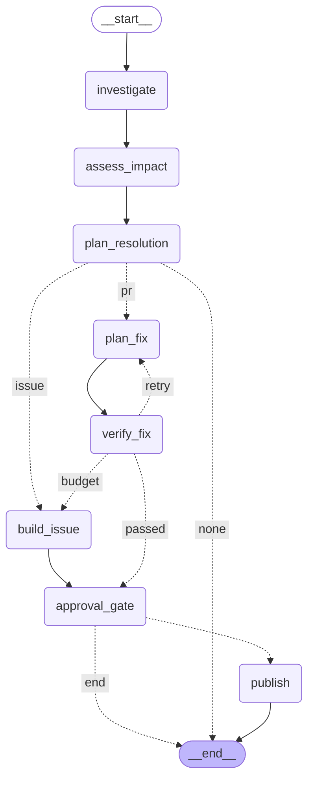

# Phase 6b — crash-safe publishing, checkpointed workflow, approval gate, demo

Date: 2026-10-22 · Scope: Phase 6 tasks 0–4 — publisher hardening, the
LangGraph incident workflow (`ARCHITECTURE.md` §10.1/§10.2), the interrupt/resume
human approval gate, `dqs incident run|approve|reject|status`, and `dqs demo`.
Phase 7 (Streamlit) is **not** started. Companion review packet:
`docs/review/phase-6b-review.md`.

## What was built

**Publisher hardening (Task 0)**

* `sql/003_publication_status.sql` — dedupes legacy `dq.publications` rows, adds
  `status` (`pending`/`done`) and a unique index on `(incident_id, kind)`;
  `db.py` replays it with the other idempotent scripts.
* `publish/store.py` — `PublicationStore` now exposes `find` (completed rows
  only), `has_pending`, `begin`, `complete` and `record`; `DbPublicationStore`
  writes the pending marker before any external call.
* `publish/base.py` — the publisher inserts `pending`, passes `retry=True` when
  a previous attempt crashed, and flips the row to `done` only after the
  external write. `ApprovalDecision` now models approve **and** reject
  (`decision`, `note`, `auto`); a rejection needs a note and auto-approval can
  only approve.
* `publish/diff.py` — patch paths are repository-root-relative
  (`warehouse/dbt_project/models/...`).
* `publish/github.py` — live mode compares each base-branch file hash with the
  local pre-patch content and refuses with "push local commits first"; a
  deterministic issue marker recovers a pending issue publication.
* `publish/body.py` — every verification criterion is rendered with its observed
  value, impact is computed from the same structured report as the table, all
  downstream models are listed (with a column-lineage marker), the status comes
  from the real approval, follow-ups come from the category playbook, the title
  is conventional, confidence is labeled "model-reported, uncalibrated",
  rationale sits with the diff, Risk contains only risk, and the fingerprint is
  in the footer.
* `publish/dry_run.py` — passes the approval through to the same renderer and
  records the same pending/done lifecycle.

**Workflow (Task 1)**

* `models/state.py` — `WorkflowState` (TypedDict), `WorkflowBudget` snapshot and
  `WorkflowOutcome`; no engine/client/publisher is ever checkpointed.
* `workflow/journal.py` — `WorkflowJournal` protocol, `DbJournal` over
  `dq.incidents`, and a real `MemoryJournal` test double. `resolution` is merged,
  not replaced, so routing reasons survive approval/publication.
* `workflow/nodes.py` — `investigate`, `assess_impact`, `plan_resolution`,
  `plan_fix`, `verify_fix`, `build_issue`, `approval_gate`, `publish`; every node
  records its step in `dq.agent_steps`, the status-changing nodes write
  transitions with a reason, and all nodes honour the shared budget and
  wall-clock limit. `publish` reloads persisted artifacts before rendering.
* `workflow/graph.py` — the exact §10.2 wiring and pure routing predicates.
* `workflow/runner.py` — `SqliteSaver` at `data/checkpoints.sqlite`,
  `thread_id=incident_id`, `run`/`resume`, redacted failure handling, and
  `make_deps` for the production services.
* `incidents.py` — merged `save_resolution`; `agents/fixer.py` refactored into
  `plan_attempt`/`verify_attempt` with the old `plan_fix` loop preserved;
  `agents/investigator.py` accepts an explicit tool registry for tests.
* `config.py` — `INCIDENT_TIMEOUT_SECONDS` default raised to 900 s.

**CLI and demo (Tasks 2–3)**

* `cli.py` — `dqs incident run|approve|reject|status` and `dqs demo`
  (`--fault` repeatable, `--yes`, `--reset`), with a compact outcome, approval
  summary, diff excerpt and timeline printer.
* `demo.py` — creates/resets a **separate** `dqs_demo` database from
  `template0`, seeds 30 baseline days, approves contracts, injects the fault,
  runs the real monitor and workflow, prompts (or auto-approves explicitly) and
  returns the preview paths and `dq.agent_steps` timeline.
* `dbt_run.py` — `dbt_env` builds the child environment from a small allowlist
  and overrides every `PG*` variable from `Settings`, so a demo build cannot
  write to the warehouse.
* Tests: `tests/unit/test_workflow.py` (12), `test_cli_incident.py` (5),
  `test_publish_*` additions, `test_dbt_env.py`, `test_demo.py`,
  `tests/integration/test_publish_db.py`, `test_publish_cli_e2e.py`.

## How to run it

```powershell
cd 'D:\study\python\data steward'

# quality gates
.venv\Scripts\python -m ruff check src tests
.venv\Scripts\python -m ruff format --check src tests
.venv\Scripts\python -m mypy src
.venv\Scripts\python -m pytest -m "not integration and not llm" -q

# Phase 6b unit acceptance (no DB, no network, fake LLM)
.venv\Scripts\python -m pytest tests\unit\test_workflow.py tests\unit\test_cli_incident.py tests\unit\test_publish_base.py tests\unit\test_dbt_env.py tests\unit\test_demo.py -q

# real Postgres integration (publish lifecycle + CLI)
.venv\Scripts\python -m pytest -m integration -q

# incident lifecycle (after a real monitor/incident exists)
.venv\Scripts\dqs incident run <incident-uuid>
.venv\Scripts\dqs incident status <incident-uuid>
.venv\Scripts\dqs incident approve <incident-uuid> --note "reviewed"
.venv\Scripts\dqs incident reject  <incident-uuid> --note "not this batch"

# the whole story in the isolated demo database (dry-run by default)
.venv\Scripts\dqs demo --yes --reset

# interactive approval instead of --yes
.venv\Scripts\dqs demo
```

`dqs demo` uses the configured LLM. It refuses to touch the warehouse by
construction: the engine is bound to `dqs_demo` and dbt receives `PGDATABASE`
from that same `Settings` copy.

## Acceptance results

| # | Criterion | Verdict | Evidence |
|---|---|---|---|
| 1 | Idempotent publication key and replayable SQL | PASS | `test_pending_then_done_lifecycle_and_the_unique_key`: two `begin()` calls produce one row, `pending` is visible before completion, `find` ignores it, `complete` flips it to `done`; `test_sql_003_replays_safely` replays every SQL file. |
| 2 | Pending crash window is recoverable | PASS | `test_a_pending_row_is_completed_by_the_next_dry_run_attempt` (dry-run), `test_pending_issue_retry_recovers_the_existing_issue_by_marker` (live issue), `test_an_existing_branch_and_pr_are_reused_after_a_crash` (live PR). |
| 3 | PR body corrections | PASS | `tests/unit/test_publish_body.py` asserts observed values for every criterion, impact derived from the rendered data, downstream models + column lineage, real approval state, category playbook follow-ups, conventional title, confidence label, rationale under the diff, risk-only Risk, fingerprint footer. The real demo preview below shows the same sections. |
| 4 | Repo-root-relative diff and base-hash guard | PASS | `build_file_patches` emits `warehouse/dbt_project/models/...`; `test_the_rendered_patch_applies_from_the_repository_root` runs `git apply --check` from the repo root; `test_refuses_when_the_base_branch_file_differs_from_the_local_checkout` asserts the "push local commits first" refusal. |
| 5 | Graph matches §10.2 | PASS | Mermaid generated from the compiled graph (below); `test_compiled_graph_diagram_names_every_node` names all eight nodes. |
| 6 | PR route waits at the gate, then publishes once | PASS | `test_pr_path_interrupts_then_publishes_after_approval`: status `awaiting_approval`, publisher sees zero calls, resume publishes once, status `resolved`. |
| 7 | Non-eligible category or low confidence files an ISSUE | PASS | `test_non_eligible_or_low_confidence_goes_to_an_issue` covers both a non-PR category and confidence < 0.6. |
| 8 | Failed verification retries, then passes | PASS | `test_a_failed_verification_retries_then_publishes_the_passing_attempt` (two attempts, one publication). |
| 9 | Exhausted attempts file an ISSUE with every attempt | PASS | `test_exhausted_attempts_file_an_issue_with_every_attempt` asserts the failed attempts are in the issue draft and no PR is published. |
| 10 | Rejection ends without publishing | PASS | `test_rejection_ends_the_run_without_publishing`: status `rejected`, no publisher calls, note stored. |
| 11 | NONE ends without a gate | PASS | `test_warning_only_resolution_ends_without_a_gate`: status `resolved`, no interrupt, no publication. |
| 12 | Interrupt/resume across a process restart publishes exactly once | PASS | `test_interrupt_and_resume_across_a_new_process_object_publish_once` uses a new `IncidentWorkflow` over the same SQLite checkpoint file. |
| 13 | Budget overrun escalates to ISSUE with partial findings | PASS | `test_budget_exhaustion_files_an_issue_with_partial_findings`. |
| 14 | Wall-clock timeout escalates to ISSUE | PASS | `test_wall_clock_timeout_escalates_to_an_issue`. |
| 15 | Node exception marks failed and keeps the checkpoint | PASS | `test_node_exception_marks_the_incident_failed_and_keeps_the_checkpoint`: status `failed`, redacted reason, `assess_impact` still in `snapshot.next`. |
| 16 | Status transitions recorded on every path | PASS | The PR test asserts `[INVESTIGATING, INVESTIGATING, AWAITING_APPROVAL, RESOLVED]`; rejection/NONE/failure tests assert their terminal statuses and reasons. |
| 17 | Auto-approval is explicit and visibly labeled | PASS | `test_auto_approval_can_only_approve`, `test_approval_state_replaces_the_stale_investigating_status` (`approved (auto, demo mode)`); the real preview below shows it. |
| 18 | `dqs incident run|approve|reject|status` wired | PASS | `tests/unit/test_cli_incident.py` (5 tests): auto-approve flag, approve note/approver, empty rejection note refused before work, reject payload, invalid id before any engine. `dqs incident status` was also run against the real demo incident (below). |
| 19 | `dqs demo` runs the whole story in `dqs_demo` | PASS | Real run below: incident `86a9bc7a`, status `resolved`, one PR preview after 2 verified attempts, 30 baseline days, fault `column_rename:orders.customer_id:new_name=cust_id`, dry-run; the same run family also produced a real ISSUE escalation. |
| 20 | Quality gates | PASS | `ruff check` / `ruff format --check` clean (155 files formatted), `mypy src` clean (96 files); unit **557 passed, 1 skipped**, integration **92 passed, 6 skipped** (LLM tests skipped by marker). |
| 21 | Warehouse untouched | PASS | After the demo: 30 batches, max `batch_20260130`, 0 incidents, 0 agent steps, 0 fix attempts, 0 publications (checked below). |
| 22 | Only `dqs_demo` remains | PASS | `pg_database` contains `dqs_demo` in addition to `warehouse`, `postgres`, `template0` and `template1`; no `dqs_sandbox_*` schemas remained. |

### Compiled graph (Mermaid, generated from `draw_mermaid`)



### Real `dqs demo --yes` run

Third real run, 2026-10-22, with the configured model (`openai/gpt-oss-120b`
via the OpenAI-compatible endpoint). Command:

```powershell
.venv\Scripts\dqs demo --yes --reset
```

Transcript (abridged; full log in the git-ignored `out/demo-6b.log`):

```text
demo database=dqs_demo warehouse=warehouse
fault=column_rename:orders.customer_id:new_name=cust_id mode=dry_run
auto-approve enabled (--yes): the published artifact will be labeled as auto-approved
preparing dqs_demo (reset=True)
seeding 30 baseline days and building dbt models
approving generated contracts
injecting 1 fault(s) on 2026-01-31 and rebuilding
monitor created 1 incident(s); running the workflow
workflow finished: status=resolved attempts=2
incident 86a9bc7a status=resolved resolution=PR attempts=2
  database=dqs_demo baseline_days=30 fault_date=2026-01-31
  faults=column_rename:orders.customer_id:new_name=cust_id
  monitor created 1 incident(s)
...
published pr (dry_run)
file:///D:/study/python/data%20steward/out/pr_previews/86a9bc7a.md
  body:  D:\study\python\data steward\out\pr_previews\86a9bc7a.md
  patch: D:\study\python\data steward\out\pr_previews\86a9bc7a.patch
```

Timeline from `dq.incidents` + `dq.agent_steps` in `dqs_demo`:

| Fact | Value |
|---|---|
| Incident | `86a9bc7a-ccbb-4cd0-ade3-b56bdf8b5e2a` (short `86a9bc7a`) |
| Resolution / status | `PR` / `resolved` |
| Workflow window | 10:57:26.475Z → 10:59:26.453Z (≈ 120 s) |
| Steps | 26 (`investigate` 15, `assess_impact`/`plan_resolution` 1 each, `plan_fix` 2, `verify_fix` 2, `approval_gate` 1, `publish` 2) |
| Tokens | 18,688 input + 2,849 output across 8 LLM calls |
| Approval | `approve`, `approver=auto`, `auto=true`, 10:59:26.427Z |
| Publication | one `pr` row, `mode=dry_run`, `status=done`, `reused=False` |
| Preview | `out/pr_previews/86a9bc7a.md` + `.patch` |

`dqs incident status 86a9bc7a` (with `PGDATABASE=dqs_demo`) independently printed
`status=resolved severity=breaking table=raw.orders`, the stored `PR`
resolution with `approver=auto`, `status_reason=publication approved`, and
`checkpoint ...\data\checkpoints.sqlite (present)`.

Attempt 1 (10:58:51) replaced `customer_id` with `cust_id` for every batch.
The verifier rejected it: `dbt_build` FAIL, `contract_conformance` FAIL
(null rate 96.72% vs 0.00% allowed), while `row_preservation` and
`targeted_check` passed. Attempt 2 (10:59:26) used
`coalesce(customer_id, cust_id)::integer`; `dbt build` passed, contract
conformance had 0 violations on 14,362 rows, row preservation was
14,362/14,362 (100%), the targeted check found 0 nulls, and the sandbox was
cleaned up (5.73 s). The publisher then wrote one `done` row and the two
preview files.

The rendered body was checked end-to-end, not just by unit tests: it contains
the root cause (`SOURCE_COLUMN_RENAMED`, 0.95, rejected hypotheses), the impact
table (`stg_orders` + three exposures, blast radius 200.0), the diff and
rationale, every criterion with its observed value, follow-ups, the
fingerprint, and `Status: approved (auto, demo mode)`. There is no stale
`investigating` status (the bug the first real run exposed, fixed in
`34696ec`).

The investigation hit the known model-error path: step 11 recorded an LLM call
with 0 tokens after 26,815 ms, then `llm_error` → retry (step 13: 3,032/802
tokens, 25,171 ms) → `model_error_recovered` → `final_channel`. The run still
produced a valid root cause; this is visible recovery, not a hidden retry.

**Escalation run (same fault, earlier real run).** The second real run used the
same fault and model, but the fixer proposed the non-coalescing
`cust_id` replacement on all three attempts. The verifier rejected each one
(`dbt_build` and `contract_conformance`; null rate 96.72%), the attempts were
exhausted, and the workflow filed an ISSUE instead of a PR:
`out/issue_previews/cae4d758.md` (incident
`cae4d758-13be-4490-b2fb-707566ba80e5`) contains all three failed attempts,
their failed criteria, and a redacted dbt excerpt. This is the honest negative
outcome of the same model and the evidence that escalation carries the partial
findings.

**Post-run database checks** (fresh queries after the successful run):

* `warehouse`: 30 batches (`batch_20260101`…`batch_20260130`), 0 incidents,
  0 agent steps, 0 fix attempts, 0 publications, no `dqs_sandbox_*` schema.
* `dqs_demo`: 31 batches (30 baseline days + the faulted 2026-01-31), the one
  resolved incident above, and its one publication row.
* `pg_database`: `dqs_demo`, `warehouse`, `postgres`, `template0`,
  `template1` only.

On this machine the 30-day seed plus per-day dbt builds took about 18 minutes;
the workflow itself took 2 minutes. That is the real cost of the demo, not a
"2-minute" claim.

## Design choices and why

* **The external side effect is bracketed by a durable marker.** A publication is
  not a single insert after the fact; `pending` is written first, so a crash is a
  fact the retry can see. Combined with a deterministic branch/issue marker,
  the retry updates one artifact instead of creating another (DECISIONS 113).
* **The unique index is the backstop, not the algorithm.** `(incident_id, kind)`
  is unique in Postgres, but the publisher still asks `find`/`has_pending`
  first so it can decide whether to reuse or recover. The index prevents two
  writers from both believing they are first (DECISIONS 113).
* **State is data; services are dependencies.** Checkpointing a connection or a
  token would make the file dangerous and non-portable. `WorkflowState` holds
  only serializable values, while `WorkflowDeps` is supplied by the runner. That
  is what makes "resume in a new process" a real test rather than a mock
  (DECISIONS 109).
* **The approval gate is an interrupt, not a status flag.** LangGraph persists
  the paused position; the human decision arrives as a typed resume value. The
  graph cannot proceed on a stale boolean, and a rejection is a first-class
  terminal state (DECISIONS 111).
* **Auto-approval is a visible capability, not a default.** `--yes` and
  `--auto-approve` set an explicit state flag; the approver is `auto`, and the
  artifact says `approved (auto, demo mode)`. A benchmark cannot silently look
  like a human review (DECISIONS 111, 116).
* **One budget for the whole incident.** Investigation, planning and verification
  share the same tracker and clock, because each can consume the resource the
  others need. Exhaustion is routed to an ISSUE with the partial state; the
  system never spins (DECISIONS 110).
* **The demo is a separate database with a derived environment.** The safety
  property is structural: `PGDATABASE=dqs_demo` is in the engine and in the dbt
  child environment, and the child environment is an allowlist. A stale shell
  variable cannot redirect a 30-day seed into the warehouse (DECISIONS 115).
* **Publishing reads persisted artifacts.** `publish` reloads the incident and
  overlays the run's typed root cause and impact before rendering. The first
  real run exposed the stale-object bug (the preview claimed no root cause);
  the fix and its regression assertion are in `34696ec`.

## Concepts used

* **Durable execution / checkpointing.** A workflow is a state machine whose
  state and next node are persisted after each step. `thread_id=incident_id`
  names the stream; a new process can load the same stream and continue. This is
  the same idea as a write-ahead log for business logic.
* **Interrupts are resumable effects.** LangGraph records that a node paused at
  `interrupt`. Resuming re-enters the node with the human's payload, so the
  node must be written to tolerate being entered twice. The gate only stamps
  `awaiting_approval` once and persists the decision after the interrupt.
* **Two-phase publication / idempotency.** Writing `pending` before an external
  call and `done` after is a miniature two-phase commit. The external system
  (GitHub, or a preview file) is made idempotent by a deterministic key
  (branch name / issue marker), so a retry can finish an interrupted attempt
  instead of duplicating it.
* **Compare-and-swap against the base branch.** The live publisher reads the
  base blob hash and refuses if the local pre-patch content differs. This is
  optimistic concurrency control: the write is only valid if the base has not
  changed since the diff was reviewed.
* **Least-privilege subprocess environments.** A child process inherits the
  parent's environment by default, including secrets. Building the dbt
  environment from an allowlist and explicit `PG*` values is the principle of
  least privilege applied to process creation.
* **Bounded autonomy as a shared resource.** A token budget and a wall-clock
  deadline are global constraints, not per-node hints. Enforcing them in one
  tracker and turning exhaustion into a routing outcome keeps the system from
  looping or overspending.

## Deviations from the docs

* **Status reasons use the existing `resolution` JSONB** instead of a new
  history table (`status_reason`). The latest status and its timestamp are in
  `dq.incidents`; the audit trail is in `dq.agent_steps` (DECISIONS 112).
* **`INCIDENT_TIMEOUT_SECONDS` default is 900 s**, not the earlier 300 s. This
  is the documented default in `.env.example`/Settings after the change; an
  operator can still lower it (DECISIONS 110).
* **The publisher's issue/PR retry recovery is marker-based**, not a generic
  "list everything and compare". The deterministic branch and issue marker are
  the only keys needed for one incident (DECISIONS 113).
* **`dqs demo` is dry-run unless `GITHUB_MODE=live`.** No real GitHub token or
  test repo was configured, so the live adapter remains fake-client tested
  (same limitation as Phase 6a).
* **The demo seeds 30 days with one dbt build per day.** This is faithful to
  the production seed path but takes minutes on this machine, not the "2-minute
  story" slogan. A snapshot/restore optimization belongs to Phase 8.

## Known limitations / TODO

* **No real live PR/issue in this phase.** The protocol and safety rules are
  tested against the recording fake; the PyGithub adapter is not network-tested.
  A real token/repo run remains the optional Phase-6 acceptance item.
* **Single-writer assumption.** `dq.publications` is unique, but `find` +
  `begin` is not a transaction that excludes a second process; concurrent
  publications for one incident are unsupported.
* **Crash after the external write but before `complete`.** The pending row and
  the deterministic marker make the common retry safe; a live PR whose branch
  exists but whose PR was never opened still depends on the adapter's reuse
  logic, which is covered by the fake but not against the real API.
* **Status history is not a table.** `dq.incidents` holds the latest status and
  `updated_at`; detailed transitions are in `dq.agent_steps`. A UI that wants a
  full timeline should read the steps, not the incident row.
* **Checkpoint files accumulate.** There is no retention/pruning policy for
  `data/checkpoints.sqlite`; one thread per incident is intentional for audit.
* **The workflow's `publish` node passes the incident's stored `resolution`
  through the publisher body via the approval decision.** The body's status is
  the approval label, not a live re-read of `dq.incidents`; this is deliberate
  because the status after publication is `resolved`, while the reviewed
  artifact must say what the human approved.
* **Demo baseline is fixed at 30 days ending 2026-01-30.** It is a story, not a
  configurable historical replay; changing `BASELINE_DAYS` changes the fault
  date and is not exposed as a CLI flag.
* **`dbt tests` is rendered as "not recorded" when the verifier did not record a
  separate criterion**, even though `dbt_build` passed with tests. The criterion
  contract is honest about what was measured; a future verifier can add an
  explicit `dbt_tests` criterion.
* **The real model can emit malformed tool names.** The run below records the
  recovery path (`llm_error` → `model_error_recovered` → `final_channel`); the
  investigation continued and produced a valid root cause. This is model
  behaviour, not a hidden retry.
