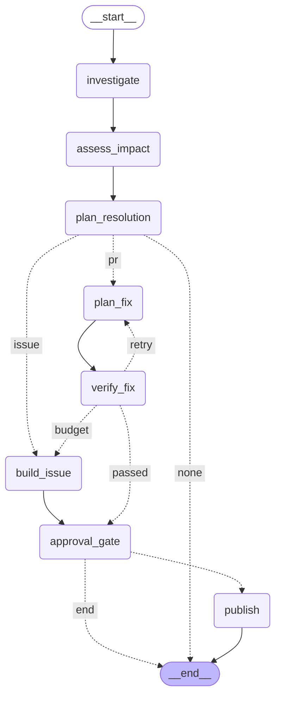

# Phase 6b review packet

Date: 2026-10-22 · Scope: Phase 6 tasks 0–4 — publisher hardening, the
LangGraph incident workflow (`ARCHITECTURE.md` §10.1/§10.2), the
interrupt/resume approval gate, `dqs incident run|approve|reject|status`, and
`dqs demo`. Phase 7 (Streamlit) is **not** started. Companion:
`docs/phase-notes/phase-6b.md`.

## What to review first

1. `src/dqs/publish/store.py` + `src/dqs/publish/base.py` — the pending/done
   publication lifecycle, `find` returning only completed rows, the retry flag,
   and the unique-key backstop. `sql/003_publication_status.sql` is the schema
   change.
2. `src/dqs/publish/github.py` — the base-branch hash guard, the deterministic
   issue marker, and the refusal message "push local commits first".
3. `src/dqs/publish/diff.py` + `src/dqs/publish/body.py` — repository-root
   relative paths, `git apply --check`, and every corrected PR-body section
   (observed values, impact table/sentence, downstream column lineage, real
   approval state, follow-ups, title, confidence label, rationale, risk,
   fingerprint).
4. `src/dqs/workflow/graph.py` — the exact §10.2 topology and the three pure
   routing predicates (`NONE` ends, PR/ISSUE, retry/exhausted/budget).
5. `src/dqs/workflow/nodes.py` — the approval gate (idempotent on resume),
   `publish` (reloads persisted root cause/impact), budget/timeout handling,
   and the defence-in-depth checks before an external write.
6. `src/dqs/workflow/runner.py` — `SqliteSaver`, `thread_id=incident_id`,
   `run`/`resume`, redacted failure handling, and the retained checkpoint.
7. `src/dqs/demo.py` + `src/dqs/dbt_run.py` — `dqs_demo` isolation,
   `template0` creation/reset, `--reset`, the approval callback, and the
   `dbt_env` allowlist that overrides `PG*`.
8. `tests/unit/test_workflow.py` and `tests/unit/test_cli_incident.py` — the
   acceptance-style routing/resume/CLI tests. No network, no Postgres, fake
   LLM, real SQLite checkpointer.

## Verdict table

| Area | Verdict | Evidence |
|---|---|---|
| Unique publication key + replayable SQL | PASS | `test_pending_then_done_lifecycle_and_the_unique_key`, `test_sql_003_replays_safely` |
| Pending crash window recoverable | PASS | dry-run pending completion test; live branch/PR reuse test; live issue marker test |
| PR-body corrections | PASS | `test_publish_body.py` (observed values, impact, lineage, approval, follow-ups, title, confidence, rationale, risk, fingerprint) + real preview |
| Repo-root diff + base-hash guard | PASS | `git apply --check` test; fake-client base mismatch refusal |
| §10.2 topology | PASS | Mermaid below; all eight nodes asserted |
| PR route gates then publishes once | PASS | `test_pr_path_interrupts_then_publishes_after_approval` |
| Non-eligible/low confidence → ISSUE | PASS | `test_non_eligible_or_low_confidence_goes_to_an_issue` |
| Retry → pass | PASS | `test_a_failed_verification_retries_then_publishes_the_passing_attempt` |
| Exhausted → ISSUE with attempts | PASS | `test_exhausted_attempts_file_an_issue_with_every_attempt` |
| Reject → END, nothing published | PASS | `test_rejection_ends_the_run_without_publishing` |
| NONE → END, no gate | PASS | `test_warning_only_resolution_ends_without_a_gate` |
| Restart/resume publishes once | PASS | new graph object over the same checkpoint file |
| Budget overrun → ISSUE with partial findings | PASS | `test_budget_exhaustion_files_an_issue_with_partial_findings` |
| Timeout → ISSUE | PASS | `test_wall_clock_timeout_escalates_to_an_issue` |
| Node exception → failed + checkpoint kept | PASS | `test_node_exception_marks_the_incident_failed_and_keeps_the_checkpoint` |
| Status transitions each path | PASS | asserted status lists/terminal states in the workflow tests |
| Auto-approval explicit + labeled | PASS | `test_auto_approval_can_only_approve`; body test; real preview |
| CLI `run|approve|reject|status` | PASS | `tests/unit/test_cli_incident.py` (5 tests) + real `status` call |
| `dqs demo` whole story | PASS | real `86a9bc7a` run: `resolved`, PR after 2 verified attempts, 30 baseline days in `dqs_demo`, dry-run preview; plus a real ISSUE escalation (`cae4d758`) |
| Warehouse untouched / only `dqs_demo` | PASS | see phase note's post-run checks |
| Quality gates | PASS | ruff/format/mypy clean (96 source files); unit 557 passed / 1 skipped; integration 92 passed / 6 skipped |

## Compiled graph

## What the reviewer should poke at

* **Live GitHub remains fake-client only.** There is no token/repo in this
  workspace, so `GitHubPublisher` is tested against a recording protocol. The
  base-hash branch and issue-marker recovery are the two paths most worth a
  real-repo test later.
* **Publication concurrency is still single-writer.** The unique index prevents
  duplicate keys, but `find` + `begin` is not an atomic "claim". Do not run two
  publishers for the same incident concurrently.
* **Checkpoint retention is unbounded.** `data/checkpoints.sqlite` keeps one
  thread per incident for audit; no pruning policy exists yet.
* **Model variance is real and visible.** On the same F1 scenario this model
  sometimes proposes `cust_id::integer` without `coalesce`; the deterministic
  verifier rejects it (96.72% nulls) and the workflow exhausts the configured
  attempts into an ISSUE. It does not pretend the fix passed.
* **`dbt tests` is not a separate verifier criterion.** The body says "not
  recorded" unless the verifier records it; `dbt_build` does include dbt tests
  in its PASS detail.
* **The demo is a story, not a benchmark.** It uses one real model run over a
  fixed 30-day baseline; do not quote it as a benchmark result
  (AGENTS.md §7.9).
